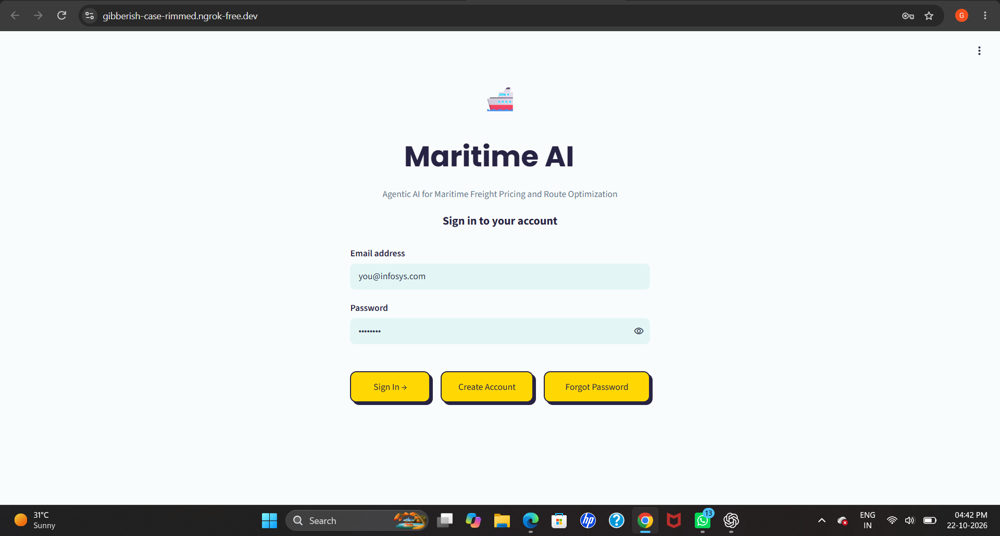
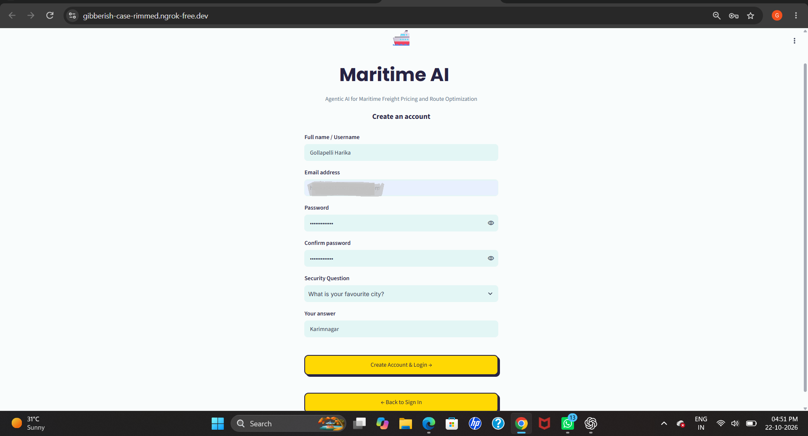
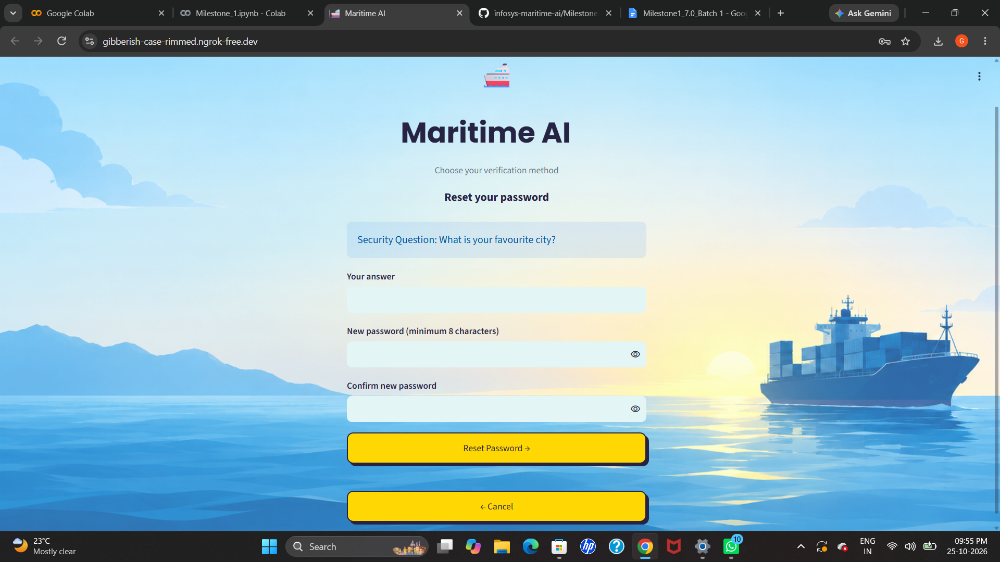
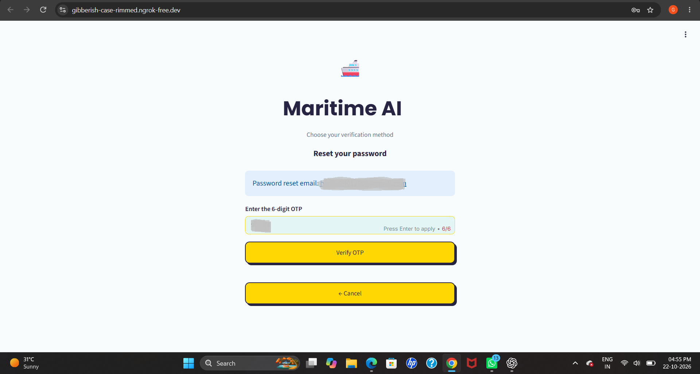
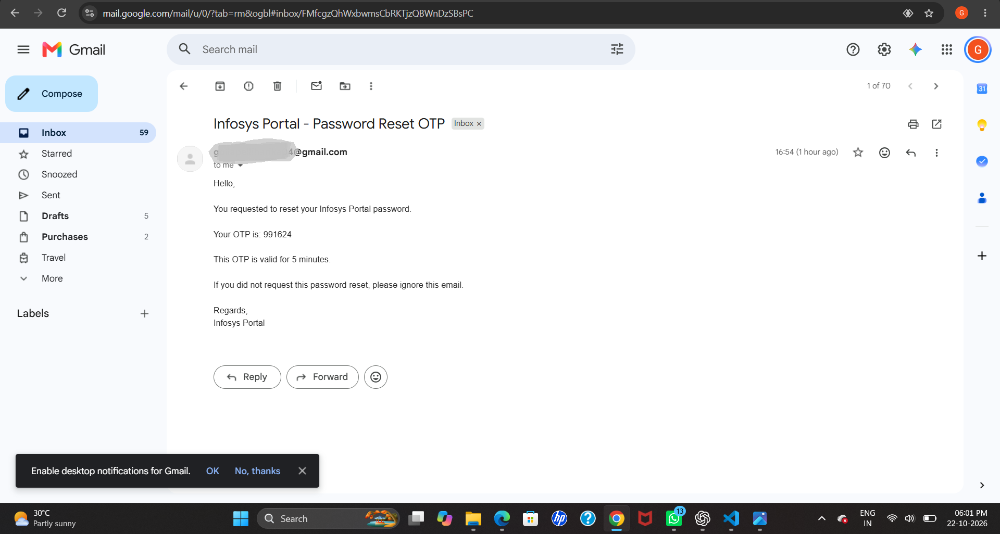
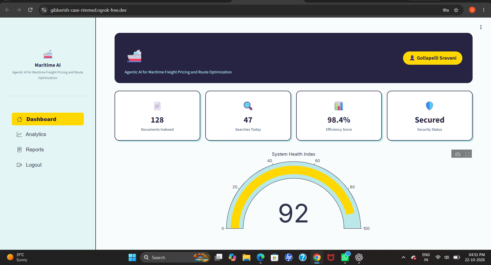

# Milestone 1
# Milestone 1: Maritime AI Authentication Portal

## 1. Overview

Milestone 1 focuses on building an authentication portal for the Infosys Maritime AI project. The application allows users to create accounts, log in securely, recover forgotten passwords, and access dashboards based on their roles.

The project also integrates email-based OTP verification for password recovery.

## 2. Features Implemented

* **User Signup:** Users can register using their name, email, and password.
* **User Login:** Registered users can log in using their email and password.
* **Password Security:** Passwords are hashed using bcrypt before being stored in the database.
* **Forgot Password — Security Question:** Users can verify their security answer to reset their password.
* **Forgot Password — Email OTP:** Users can receive a six-digit OTP through Gmail to verify their email before resetting their password.
* **OTP Expiration:** OTPs expire after five minutes.
* **JWT Authentication:** JSON Web Tokens are used for session handling.
* **Role-Based Dashboards:** Separate dashboards are available for the administrator and regular users.
* **Input Validation:** The application checks required fields and password requirements.
* **Database:** SQLite stores user account information.

## 3. Technology Stack

| Technology   | Purpose                                                 |
| ------------ | ------------------------------------------------------- |
| Python       | Application logic                                       |
| Streamlit    | User interface                                          |
| SQLite       | User data storage                                       |
| bcrypt       | Password hashing                                        |
| PyJWT        | JWT-based authentication                                |
| Gmail SMTP   | Sending password-reset OTP emails                       |
| Plotly       | Dashboard visualization                                 |
| pyngrok      | Exposing the Streamlit application through a public URL |
| Google Colab | Notebook execution and application testing              |

## 4. Project Files

```text
Milestone1/
├── README.md
├── your_notebook.ipynb
└── screenshots/
    ├── login.png
    ├── signup.png
    ├── forgot_security.png
    ├── forgot_otp.png
    ├── otp_email.png
    ├── user_dashboard.png
    └── admin_dashboard.png
```

Replace `Login page.ipynb` with your actual notebook filename. The screenshot files should be added after capturing them.

## 5. How to Run the Notebook

1. Open the `.ipynb` notebook in Google Colab.
2. Install any required Python packages if they are not already installed.
3. Open the Google Colab Secrets panel.
4. Configure the required secrets, including `GMAIL_ADDRESS`, `EMAIL_PASSWORD`, `JWT_SECRET`, and `NGROK_AUTHTOKEN`.
5. Ensure notebook access is enabled for the required secrets.
6. Run the notebook cells in the correct order.
7. Start the Streamlit application and launch the ngrok tunnel.
8. Open the generated application URL.
9. Test signup, login, both password-reset methods, and the user and administrator dashboards.

**Security note:** Never commit actual Gmail App Passwords, ngrok tokens, JWT secrets, or other credentials to GitHub. Keep them in Google Colab Secrets.

## 6. Application Screenshots

### 6.1 Login Page



### 6.2 Signup Page



### 6.3 Forgot Password — Security Question



### 6.4 Forgot Password — OTP



### 6.5 OTP Email



### 6.6 Administrator Dashboard



## 7. Milestone Summary

Milestone 1 establishes the authentication and user-access foundation for the Maritime AI project. It brings together account registration, secure password storage, password recovery, JWT-based session handling, and role-specific dashboards.
