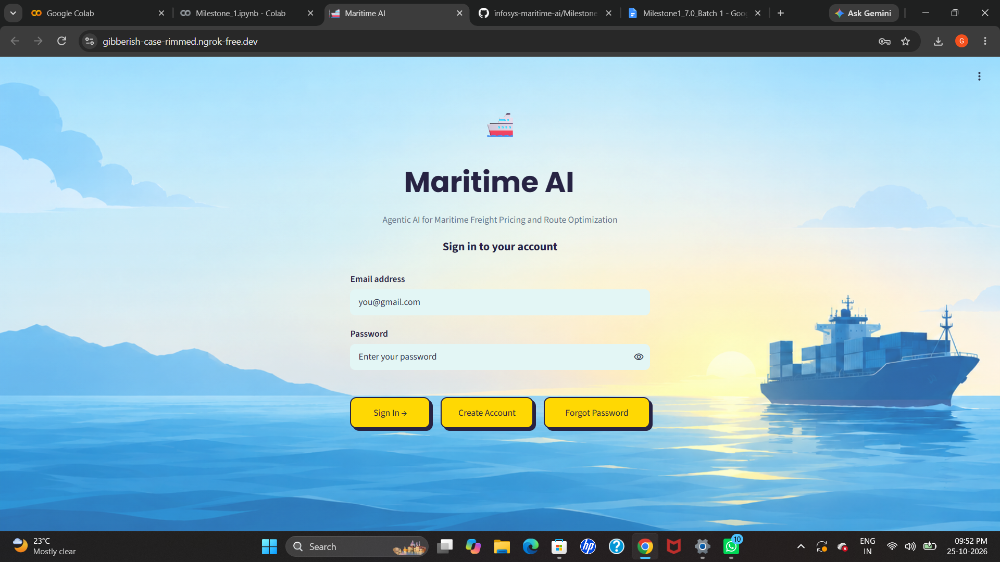
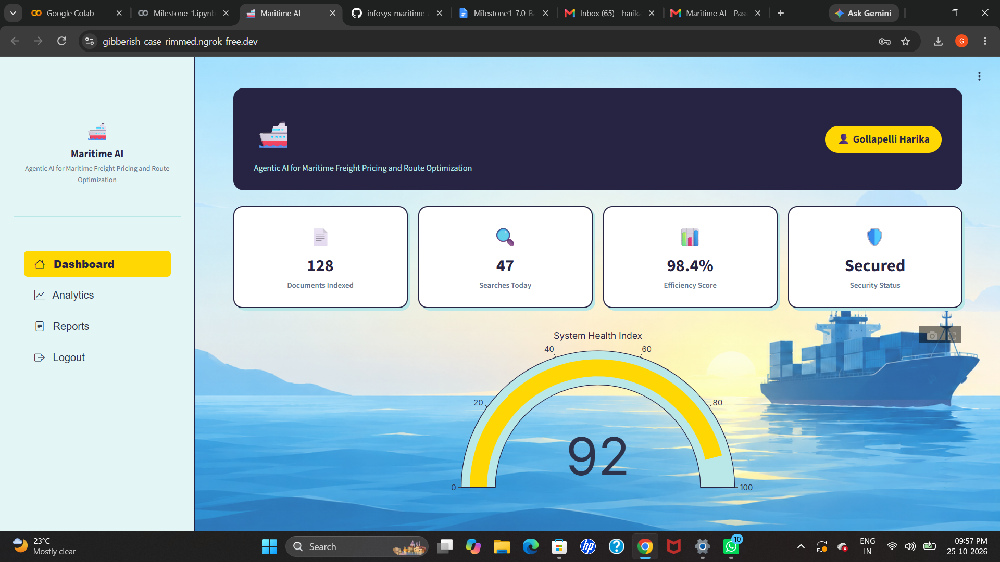

# Milestone 1
# Milestone 1: Maritime AI Authentication Portal

## 1. Overview

Milestone 1 focuses on building an authentication portal for the Infosys Maritime AI project. The application allows users to create accounts, log in securely, recover forgotten passwords, and access dashboards based on their roles.

The application also integrates email-based OTP verification for password recovery.

## 2. Features Implemented

* **User Signup:** Users can register using their name, email, and password.
* **User Login:** Registered users can log in using their email and password.
* **Password Security:** Passwords are hashed using bcrypt before being stored in the database.
* **Forgot Password — Security Question:** Users can verify their security answer to reset their password.
* **Forgot Password — Email OTP:** Users can receive a six-digit OTP through Gmail to verify their email before resetting their password.
* **OTP Expiration:** OTPs expire after five minutes.
* **JWT Authentication:** JSON Web Tokens are used for session handling.
* **Role-Based Dashboards:** Separate dashboards are available for administrators and regular users.
* **Input Validation:** The application checks required fields and password requirements.
* **Database:** SQLite stores user account information.

## 3. Technology Stack

| Technology   | Purpose                                                 |
| ------------ | ------------------------------------------------------- |
| Python       | Application logic                                       |
| Streamlit    | User interface                                          |
| SQLite       | User data storage                                       |
| bcrypt       | Password hashing                                        |
| PyJWT        | JWT-based authentication                                |
| Gmail SMTP   | Sending password-reset OTP emails                       |
| Plotly       | Dashboard visualization                                 |
| pyngrok      | Exposing the Streamlit application through a public URL |
| Google Colab | Notebook execution and application testing              |

## 4. Project Files
Milestone1/
├── README.md
├── Login page.ipynb
└── screenshots/
    ├── login.png
    ├── signup.png
    ├── forgot_security.png
    ├── forgot_otp.png
    ├── otp_email.png
    ├── user_dashboard.png
    └── admin_dashboard.png

*Note: Replace Login page.ipynb with your actual notebook filename if it differs. Add the screenshots to the `screenshots/` directory and ensure their filenames match the ones referenced in this README.*

## 5. Google Colab Secrets Configuration

Google Colab Secrets are used to store sensitive credentials securely instead of hardcoding them in the source code.

### Steps to Configure Secrets

1. Open the project notebook in Google Colab.
2. Click the **Secrets (🔑)** icon in the left sidebar.
3. Click **Add a new secret**.
4. Enter the required secret name and its corresponding value.
5. Enable **Notebook access** for each secret so the notebook can retrieve it.

### Required Secrets

| Secret Name       | Purpose                                                 |
| ----------------- | ------------------------------------------------------- |
| `GMAIL_ADDRESS`   | Gmail address used to send password-reset OTP emails    |
| `EMAIL_PASSWORD`  | Gmail App Password used for SMTP authentication         |
| `JWT_SECRET`      | Secret key used to sign and verify JWT tokens           |
| `NGROK_AUTHTOKEN` | Authentication token used to configure the ngrok tunnel |

### Generating the JWT Secret

A secure, random JWT secret can be generated using Python:

import secrets

print(secrets.token_urlsafe(48))

Copy the generated value into the Google Colab Secret named `JWT_SECRET`. Keep the value private and do not publish it in the repository.

### Configuring Gmail for OTP Verification

1. Use a Google account with 2-Step Verification enabled.
2. Generate a Gmail App Password through your Google Account security settings, if available.
3. Add your Gmail address as `GMAIL_ADDRESS` in Google Colab Secrets.
4. Add the Gmail App Password as `EMAIL_PASSWORD`.
5. Enable Notebook access for both secrets.

The application uses Gmail SMTP to send OTP emails during password recovery. A Gmail App Password should be used instead of your regular Gmail password.

## 6. ngrok Setup and Configuration

ngrok is used to expose the locally running Streamlit application through a public URL so it can be accessed and tested in a browser.

### Steps to Configure ngrok

1. Create an account on the official [ngrok website](https://ngrok.com/).
2. Open the ngrok dashboard.
3. Locate the authentication token in the setup or authentication section.
4. Copy the token.
5. Open the Google Colab notebook and click the **Secrets (🔑)** icon.
6. Add a new secret named `NGROK_AUTHTOKEN`.
7. Paste the ngrok authentication token as its value.
8. Enable Notebook access for the secret.

The notebook can retrieve the token to authenticate ngrok and create a tunnel for the Streamlit application.

**Important:** The secret name must match the name expected by the notebook code. In this project, use `NGROK_AUTHTOKEN` if that is the name your code reads.

## 7. How to Run the Notebook

1. Open the `.ipynb` notebook in Google Colab.
2. Install the required Python packages if they are not already installed.
3. Open the Google Colab Secrets panel.
4. Configure `GMAIL_ADDRESS`, `EMAIL_PASSWORD`, `JWT_SECRET`, and `NGROK_AUTHTOKEN`.
5. Enable Notebook access for the required secrets.
6. Run the notebook cells in the correct order.
7. Start the Streamlit application and launch the ngrok tunnel.
8. Open the public URL generated by ngrok.
9. Test signup, login, both password-reset methods, and the user and administrator dashboards.

## 8. Application Screenshots

### 8.1 Login Page

### 8.2 Signup Page

### 8.3 Forgot Password — Security Question

### 8.4 Forgot Password — OTP

### 8.5 OTP Email

### 8.6 User Dashboard

## 9. Security Considerations

* Never commit Gmail App Passwords, ngrok authentication tokens, JWT secrets, or other sensitive credentials to GitHub.
* Store credentials in Google Colab Secrets.
* Do not print or expose secret values in notebook output.
* If a credential is accidentally published, revoke or rotate it immediately.
* Keep private configuration files and credential files out of version control.
* The ngrok public URL may change when a new tunnel is created or the runtime is restarted.
* Google Colab runtime files and active sessions may need to be recreated after a runtime reset.

## 10. Milestone Summary

Milestone 1 establishes the authentication and user-access foundation for the Maritime AI project. It brings together account registration, secure password storage, password recovery, JWT-based session handling, and role-specific dashboards.
